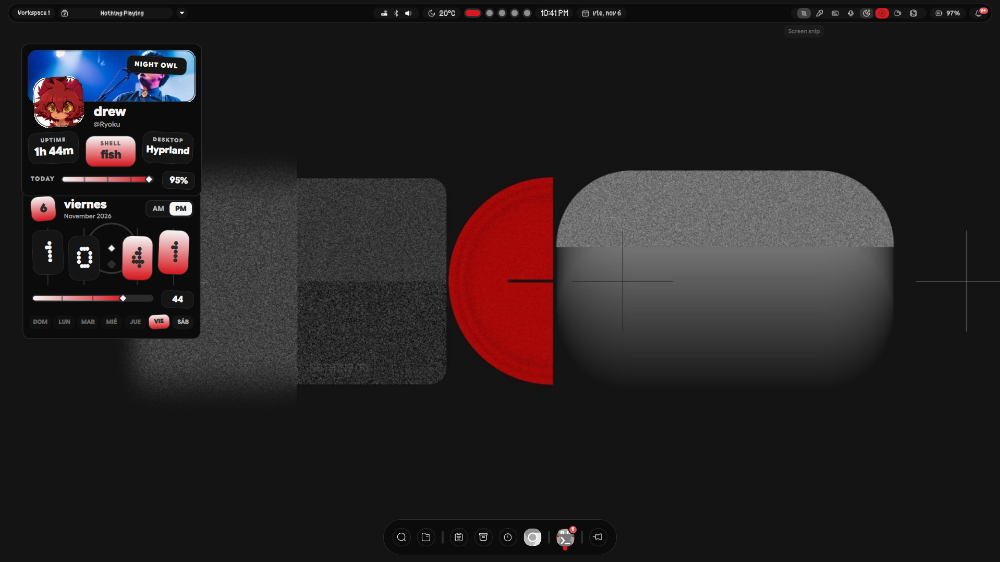
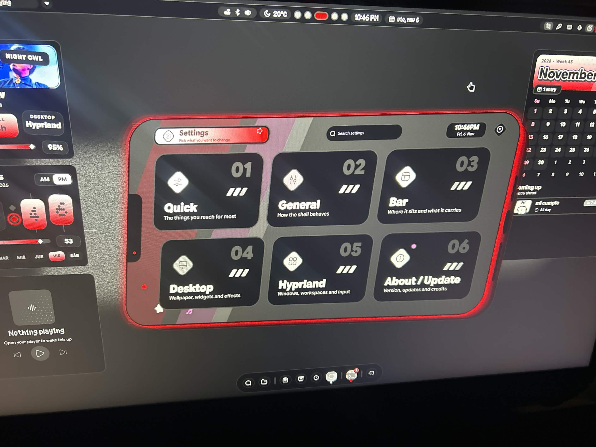
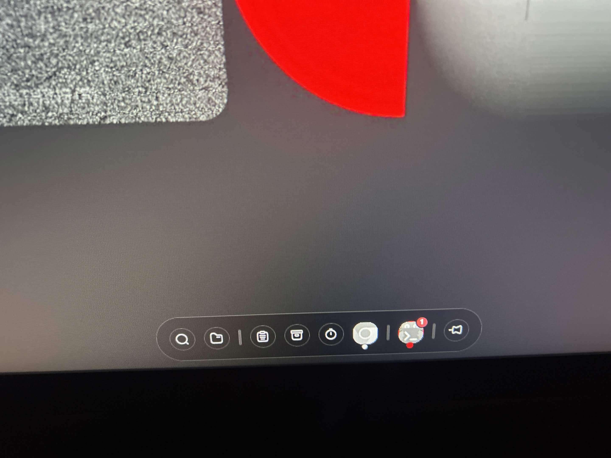

<div align="center">

# NdotShell

**Un escritorio Quickshell para Hyprland** — estilo *Nothing OS*, teléfono holograma 2.5D,  
seis canales de color y actualizaciones automáticas.

[](https://github.com/OptiJK181/NdotShell/releases/latest)
[](LICENSE)
[]()
[]()

</div>

---

## ✨ Qué trae

| Característica | Detalle |
|----------------|---------|
| **Diseño Nothing** | Barra y dock *Capsule*: slab negro 36 px, 1 px rim `#2b2b2b`, sin sombras |
| **Teléfono holograma 2.5D** | Pantalla nítida y opaca, extrusión con filamento de acento, pared translúcida, alambre trasero, halo de 3 anillos, scanlines detrás de la UI |
| **6 canales de acento** | Ndot Red (default), Mono, Amber, Lime, Blue, Violet — solo cambia el color, el diseño nunca |
| **Welcome tour** | Letra Ndot/Shell + marca de punto, fondo *dot-grid*, barrido de scanlines y *glitch* al cambiar de diapositiva |
| **Actualizaciones propias** | `stable` = rama `main`, `dev` = rama `dev` — nunca toca SekaiPop upstream |
| **Instalador 1-click** | `bash <(curl -fsSL https://raw.githubusercontent.com/OptiJK181/NdotShell/main/get.sh)` |
| **Autostart real** | Arranca solo tras reboot vía `qs-autostart` |
| **Renombrado limpio** | Corre junto a SekaiPop: `qs -c ndotshell`, config en `~/.config/ndotshell` |

---

## 🚀 Instalación rápida

```bash
# Desde una terminal (bash, zsh)
bash <(curl -fsSL https://raw.githubusercontent.com/OptiJK181/NdotShell/main/get.sh) --yes

# En fish shell
bash (curl -fsSL https://raw.githubusercontent.com/OptiJK181/NdotShell/main/get.sh | psub) --yes
```

> **Requisitos**: Arch / CachyOS / EndeavourOS, Hyprland ≥ 0.55, Quickshell, git, curl.  
> El script instala dependencias (pacman), copia la configuración, genera `monitors.lua` para tus pantallas y configura el autostart.

---

## ⌨️ Atajos principales (después de instalar)

| Acción | Tecla |
|--------|-------|
| Abrir **Apps** | `Super` (tap) |
| Abrir **Quick Panel** | `Super + N` |
| Abrir **Ajustes** | `Super + I` |
| Cheat sheet (todos los atajos) | `Super + /` |
| Cambiar tema/canal | `Super + T` → *Theme picker* |
| Power menu | `Super + Esc` |

> Todos personalizables en **Ajustes → Hyprland → Keybinds** (tablero visual).

---

## 🖼️ Capturas

| Quick Panel (teléfono) | Ajustes / Canales | Dock estilo Cápsula |
|:----------------------:|:-----------------:|:-------------------:|
|  |  |  |

> **Añade tus capturas** en `docs/screenshots/` y actualiza las rutas arriba.

---

## 🔧 Canales de actualización

| Canal | Rama | Qué trae |
|-------|------|----------|
| **Stable** (default) | `main` | Versiones testeadas, release oficial |
| **Dev** | `dev` | Cambios entre releases, para probar |

```bash
# Ver canal actual
update-check.sh channel

# Cambiar a dev
update-check.sh channel dev

# O desde la UI: Ajustes → About / Update → Update channel
```

> El shell revisa solo (si activas *Tell me about updates*) y te notifica; `Update now` descarga y reinicia solo.

---

## 🛠️ Personalización rápida

- **Tema / Canal**: `Super + T` o Ajustes → Desktop → Theme
- **Barra / Dock estilo**: Ajustes → Bar / Dock → Style (Capsule, Pill, etc.)
- **Wallpaper teléfono**: Ajustes → Quick Panel → Phone wallpaper
- **Idle / suspensión**: Ajustes → General → Idle & sleep
- **Fuentes de apps (GTK/Qt/KDE)**: Ajustes → Desktop → App fonts
- **Plugins**: Ajustes → About / Update → Get plugins

---

## 🔁 Cambiar entre NdotShell y SekaiPop

```bash
shell-use ndotshell   # usa NdotShell
shell-use sekaipop    # usa SekaiPop original
```

> Solo uno puede correr a la vez (comparten lockscreen, notificaciones, polkit).

---

## 📦 Estructura de carpetas

```
~/.config/ndotshell/          # Configuración de usuario
~/.local/state/ndotshell/     # Estado (tema, canal, etc.)
~/.cache/ndotshell/           # Caché, logs de autostart
~/.config/hypr/ndotshell_overrides.lua  # Overrides Hyprland
```

---

## 🐛 Problemas comunes

| Síntoma | Solución |
|---------|----------|
| Pantalla negra tras instalar | `hyprctl reload` o relogeate; `monitors.lua` se generó para tus pantallas actuales |
| El instalador falla en `git clone` | `NDOTSHELL_REPO=https://github.com/OptiJK181/NdotShell.git bash <(curl ...)` |
| `update-check.sh` dice `nosource` | Asegúrate de que el repo remoto es `fork` (no `origin` de SekaiPop) |
| Fuente Ndot 55 no sale | `fc-cache -fv` y reinicia Quickshell |
| Teclas multimedia no funcionan | Añade `playerctl` y `hypridle` (`sudo pacman -S playerctl hypridle`) |

---

## 🤝 Créditos y licencia

- **Original**: [SekaiPop](https://github.com/Blapples/SekaiPop) por Blapples (GPL-3.0)
- **Fork**: NdotShell — renombrado, Nothing skin, canales, holograma, welcome tour
- **Partes**: end4·dots-hyprland, matugen, Quickshell, Hyprland, Material Symbols, Google Sans Flex, emojibase, Open-Meteo, lyric providers
- **Licencia**: GPL-3.0 — ver [LICENSE](LICENSE)

---

## 📖 Docs completas

| Tema | Archivo |
|------|---------|
| Fork / merge policy | `docs/NDOT.md` |
| Changelog | `ndotshell/CHANGELOG.md` |
| Plugins | `docs/PLUGINS.md` / `docs/PLUGIN-INSTALL.md` |
| Theming / Matugen | `docs/MATUGEN-CONTROLS.md` |
| Phone click-away | `docs/PHONE-CLICK-AWAY.md` |
| Idle & sleep | `docs/IDLE.md` |

---

<div align="center">

**Hecho con ❤️ para Hyprland + Quickshell**  
¿Te gusta? ⭐ el repo y comparte tu rice en `/r/unixporn`

</div>
