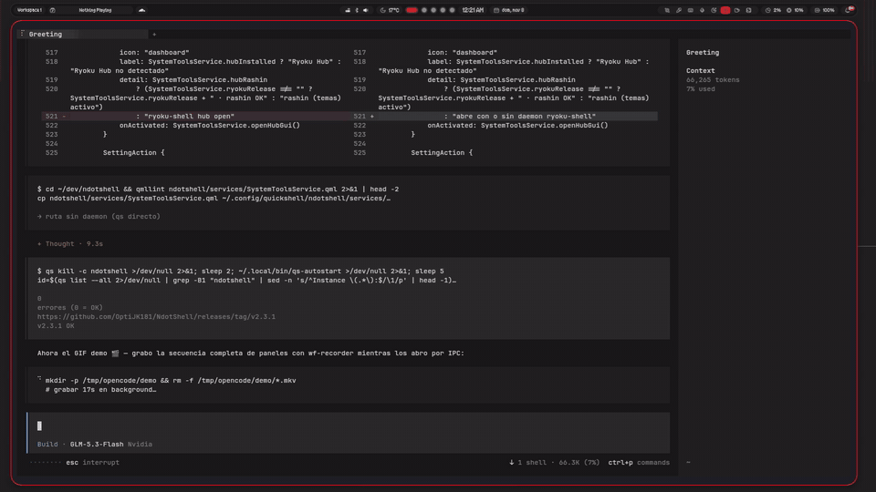

<div align="center">

<!-- wordmark dot-matrix -->


**Un escritorio Nothing OS para Hyprland** — teléfono holograma 2.5D, Dynamic Island, drawers laterales gelatinosos y canales de acento.

[](https://github.com/OptiJK181/NdotShell/releases/latest)
[](https://archlinux.org)
[](https://hyprland.org)
[](LICENSE)

<br/>

<br/>

</div>

---

## ✨ Qué hace NDotShell

Un Quickshell desktop que se siente como un **teléfono Nothing**: la barra es una cápsula negra, el centro de notificaciones es un teléfono con render holograma 2.5D, y todo — drawers, isla, dock de música — responde con animaciones gelatinosas que se conectan a los bordes.

|  |  |
|:---|:---|
| ● **TELÉFONO HOLOGRAMA** | Quick Panel 2.5D con filamento de acento, pared translúcida, halo |
| ● **DRAWERS LATERALES** | doble toque en las esquinas → Gaming y Focus se despliegan |
| ● **DYNAMIC ISLAND** | agujero negro girando con acceso a REC, Pomodoro, música |
| ● **DOCK DE MÚSICA** | vinilo girando con arte real, transporte y volumen |
| ● **MODO PRIVADO** | clipboard que nunca guarda secretos (Super + P) |
| ● **POMODORO** | ciclos 25/5 con stats persistentes y notificaciones |
| ● **SCREEN RECORDER** | pantalla, ventana o región, con/sin audio |
| ● **6 CANALES** | red · mono · amber · lime · blue · violet |
| ● **WALLPAPER DINÁMICO** | cambia por hora del día con transición suave |
| ● **RYOKU SERVICES** | Hub, Ryotunes y temas desde Ajustes — sin duplicar barras |
| ● **ACTUALIZACIONES** | stable / dev desde tu propio repo, sin reinstalar |

---

## 📸 Demo



*Doble toque → drawers gelatinosos (Gaming / Focus), Dynamic Island y dock de Música — rebote OutElastic conectado a la esquina.*

🎬 **Video vertical (TikTok / Reels):** [docs/screenshots/tiktok.mp4](docs/screenshots/tiktok.mp4) — 19 s, 1080×1920. Copy y checklist en [TIKTOK-POST.md](TIKTOK-POST.md).

<details>
<summary><b>Más capturas</b></summary>

| Panel Gaming | Panel Focus | Dock de Música |
|:---:|:---:|:---:|
|  |  |  |

</details>

---

## 🚀 Instalación

```bash
# bash / zsh
bash <(curl -fsSL https://raw.githubusercontent.com/OptiJK181/NdotShell/main/get.sh) --yes

# fish
bash (curl -fsSL https://raw.githubusercontent.com/OptiJK181/NdotShell/main/get.sh | psub) --yes
```

> Requiere Arch / CachyOS / EndeavourOS, Hyprland ≥ 0.55. El script instala dependencias, copia la config, genera `monitors.lua` para tus pantallas y configura el autostart.

<details>
<summary><b>Instalación manual</b></summary>

```bash
git clone https://github.com/OptiJK181/NdotShell.git
cd NdotShell
./install.sh --yes
```
</details>

---

## ⌨️ Atajos

| Tecla | Acción |
|---|---|
| `Super` (tap) | Apps |
| `Super + N` | Quick Panel (teléfono) |
| `Super + I` | Ajustes |
| `Super + /` | Cheat sheet |
| `Super + G` | Game Mode |
| `Super + P` | Modo privado + OSD |
| `Super + Shift + G` | Panel Gaming |
| `Super + Shift + W` | Panel Focus |
| `Super + Shift + D` | Dynamic Island |
| `Super + Shift + U` | Dock de música |
| Doble toque esquinas | Drawers / Isla / Música |
| `Super + Escape` | Power menu |

Todos reasignables en **Ajustes → Hyprland → Keybinds** (tablero visual).

---

## 🔄 Actualización

El shell se actualiza **sin reinstalar**:

- **Desde la UI**: Ajustes → Acerca de / Actualizar → Actualizar ahora
- **Por CLI**: `update-check.sh apply`
- **Canales**: `stable` (main) · `dev` (dev) — cambiables desde Ajustes o `update-check.sh channel dev`

---

## 🔒 Privacidad incorporada

- **Filtro de secretos**: contraseñas, API keys, tokens, JWTs, tarjetas — **nunca** entran al historial del clipboard
- **Modo privado**: `Super + P` pausa toda la grabación del portapapeles
- **Historial en RAM**: nada va a disco salvo lo que fijes
- **Auto-wipe al bloquear** la pantalla
- **Cero telemetría** — todo es local

---

## 📁 Estructura

```
~/.config/ndotshell/            # tu configuración
~/.local/state/ndotshell/       # estado (tema, canal, stats)
~/.cache/ndotshell/             # caché y logs
~/.config/hypr/ndotshell_overrides.lua  # overrides de Hyprland
```

---

## 🛠️ Tech

|  |  |
|---|---|
| **Shell** | Quickshell (QML) |
| **WM** | Hyprland 0.55+ (config Lua) |
| **Visualizer** | cava / analizador Python con aubio |
| **Fuentes** | Ndot 55 · Google Sans Flex · Material Symbols |
| **Iconos** | Solar Icon Set (2400+ SVGs) |

---

## 🤝 Créditos

| | |
|---|---|
| **Base** | [SekaiPop](https://github.com/Blapples/SekaiPop) por Blapples (GPL-3.0) |
| **Fork** | renombrado, Nothing skin, holograma, canales, drawers |
| **Fundación** | end4 · dots-hyprland |
| **Inspiración** | pCtrade · end4-pC |
| **Colores** | matugen |
| **Toolkit** | Quickshell · Hyprland |

---

## 📖 Docs

| Tema | Archivo |
|---|---|
| Fork / merge | `docs/NDOT.md` |
| Changelog | `CHANGELOG.md` |
| Plugins | `docs/PLUGINS.md` |
| Theming | `docs/MATUGEN-CONTROLS.md` |
| Idle | `docs/IDLE.md` |

---

<div align="center">

<br/>

```
. . .  . . .  . . .
nothing else to see
. . .  . . .  . . .
```

<br/>


<br/>

**GPL-3.0** · hecho con ❤️ para Hyprland + Quickshell

</div>